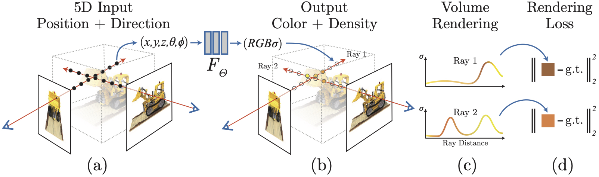

# Assignment 2: Images-to-3D NeRF Reconstruction Pipeline

本仓库在经典 `nerf-pytorch` 源码基础上实现了课程作业的完整流水线：从 GLB 模型生成 360° 多视角图像，使用 Python/pycolmap 完成 SfM 相机位姿估计，再以估算位姿训练经典 NeRF，最终输出测试视角图像、360° 视频和 GIF。实验累计制作 18 个候选对象，最终保留 10 个对象用于作业结果展示。

## 作业提交内容

- Pipeline documentation：Word 文档单独提交；本地文件为 `docs/Assignment_2_NeRF_Pipeline_Documentation.docx`，不纳入 GitHub 仓库
- 完整提示词记录：`prompts/assignment2_prompts.md`
- 10 个对象的训练配置：`configs/*_360.txt`
- SfM 位姿、统计信息与匹配可视化：`outputs/sfm/<dataset>/`
- NeRF 最终检查点、测试图像和视频：`logs/<experiment>/`
- 10 个对象的 GIF：`results/gifs/`
- 数据生成、SfM、评估与文档构建脚本：`tools/`

GitHub 仓库链接：<https://github.com/RanJiaPimpi/nerf-assignment2>

## 最终 10 个对象

| 对象 | 数据集目录 | NeRF 配置 | GIF |
| --- | --- | --- | --- |
| 盆栽 | `object_00184cc3` | `configs/plant_360.txt` | `results/gifs/plant_360.gif` |
| 草棚推车 | `object_001cfadf` | `configs/cart_360.txt` | `results/gifs/cart_360.gif` |
| 风车 | `object_0046f208` | `configs/windmill_360.txt` | `results/gifs/windmill_360.gif` |
| 烤鸡 | `object_004fb4d7` | `configs/roast_chicken_360.txt` | `results/gifs/roast_chicken_360.gif` |
| 红色车辆 | `object_00c7005a` | `configs/red_vehicle_360.txt` | `results/gifs/red_vehicle_360.gif` |
| 鸭子 | `object_00f980c0` | `configs/duck_360.txt` | `results/gifs/duck_360.gif` |
| 市场摊位 | `object_05437330` | `configs/market_stall_360.txt` | `results/gifs/market_stall_360.gif` |
| 酒桶架 | `object_0269ed15` | `configs/barrel_rack_360.txt` | `results/gifs/barrel_rack_360.gif` |
| 城堡 | `object_04794e1a` | `configs/castle_large_360.txt` | `results/gifs/castle_large_360.gif` |
| 木屋 | `object_06b9953a` | `configs/cottage_360_retry.txt` | `results/gifs/cottage_360_retry.gif` |

## 1. 环境准备

服务器上使用的环境命令如下：

```bash
source /mnt/afs/260010007/envs/miniconda3/bin/activate Self-P2IR-cu124
conda install -y configargparse imageio imageio-ffmpeg -c conda-forge
cd /mnt/afs/260010007/NeRF/nerf-pytorch-master
```

除经典 NeRF 的依赖外，数据生成与 SfM 阶段还需要 `numpy`、`Pillow`、`opencv-python` 和 `pycolmap`。具体版本可依据本机 CUDA 与 Python 环境安装。

## 2. 生成数据与估算相机位姿

将 GLB 文件放入数据目录后，先运行项目中的多视角渲染脚本生成 `train`、`val`、`test` 图像和渲染器参考位姿。随后对训练图像执行 SfM；训练时只读取 SfM 估算的位姿，不使用渲染器真实位姿。

单对象 SfM 示例：

```bash
python tools/sfm_pipeline.py --dataset object_00184cc3
python tools/sfm_pipeline.py --dataset object_0046f208 --pairing turntable --force
python tools/sfm_pipeline.py --dataset object_004fb4d7
python tools/sfm_pipeline.py --dataset object_00f980c0
python tools/sfm_pipeline.py --dataset object_04794e1a --force
```

批量处理全部数据集：

```bash
python tools/run_sfm_all.py
```

每个对象的主要输出位于 `outputs/sfm/<dataset>/`：

- `transforms_sfm_train.json`：提供给 NeRF 的估算相机位姿；
- `statistics.json`：注册图像数、重投影误差等统计信息；
- `matches/`：特征点几何匹配可视化，用于作业中的 point-matching results；
- `sparse/`：SfM 稀疏重建模型。

## 3. 使用 SfM 位姿训练经典 NeRF

训练时必须添加 `--use_sfm_poses`，使数据加载器读取 `transforms_sfm_train.json`。

单对象训练：

```bash
python run_nerf.py --config configs/plant_360.txt --use_sfm_poses
```

10 个对象批量训练：

```bash
for name in plant_360 cart_360 windmill_360 roast_chicken_360 red_vehicle_360 duck_360 market_stall_360 barrel_rack_360 castle_large_360 cottage_360_retry
do
  python run_nerf.py --config "configs/${name}.txt" --use_sfm_poses
done
```

从已有检查点渲染视频：

```bash
python run_nerf.py --config configs/plant_360.txt --use_sfm_poses --render_only
```

## 4. 视频转换为 GIF

最终 GIF 由 NeRF 的 360° RGB 渲染视频生成。以下命令将视频调整为 12 fps、宽度 512 像素并生成循环 GIF：

```bash
ffmpeg -i logs/plant_360/plant_360_spiral_200000_rgb.mp4 \
  -filter_complex "[0:v]setpts=2.5*PTS,fps=12,scale=512:-1:flags=lanczos,split[s0][s1];[s0]palettegen=max_colors=256:stats_mode=diff[p];[s1][p]paletteuse=dither=sierra2_4a" \
  -loop 0 results/gifs/plant_360.gif
```

其余对象只需替换实验名。仓库中的 10 个 GIF 均位于 `results/gifs/`。

## 5. 结果与复现检查

提交前应确认每个最终对象至少保留以下结果：

- `logs/<experiment>/200000.tar`
- `logs/<experiment>/testset_200000/`
- `logs/<experiment>/<experiment>_spiral_200000_rgb.mp4`
- `logs/<experiment>/args.txt` 与 `config.txt`
- `results/gifs/<experiment>.gif`
- `outputs/sfm/<dataset>/matches/*.png`

根目录 `.gitignore` 默认排除普通 PNG，以避免提交大量训练图像；其中已通过 `!outputs/sfm/**/matches/*.png` 单独放行 SfM 匹配图片，确保作业要求的 point-matching results 可以上传到 GitHub。

---

# Upstream NeRF-pytorch documentation


[NeRF](http://www.matthewtancik.com/nerf) (Neural Radiance Fields) is a method that achieves state-of-the-art results for synthesizing novel views of complex scenes. Here are some videos generated by this repository (pre-trained models are provided below):


This project is a faithful PyTorch implementation of [NeRF](http://www.matthewtancik.com/nerf) that **reproduces** the results while running **1.3 times faster**. The code is based on authors' Tensorflow implementation [here](https://github.com/bmild/nerf), and has been tested to match it numerically. 

## Installation

```
git clone https://github.com/yenchenlin/nerf-pytorch.git
cd nerf-pytorch
pip install -r requirements.txt
```

<details>
  <summary> Dependencies (click to expand) </summary>
  
  ## Dependencies
  - PyTorch 1.4
  - matplotlib
  - numpy
  - imageio
  - imageio-ffmpeg
  - configargparse
  
The LLFF data loader requires ImageMagick.

You will also need the [LLFF code](http://github.com/fyusion/llff) (and COLMAP) set up to compute poses if you want to run on your own real data.
  
</details>

## How To Run?

### Quick Start

Download data for two example datasets: `lego` and `fern`
```
bash download_example_data.sh
```

To train a low-res `lego` NeRF:
```
python run_nerf.py --config configs/lego.txt
```
After training for 100k iterations (~4 hours on a single 2080 Ti), you can find the following video at `logs/lego_test/lego_test_spiral_100000_rgb.mp4`.


---

To train a low-res `fern` NeRF:
```
python run_nerf.py --config configs/fern.txt
```
After training for 200k iterations (~8 hours on a single 2080 Ti), you can find the following video at `logs/fern_test/fern_test_spiral_200000_rgb.mp4` and `logs/fern_test/fern_test_spiral_200000_disp.mp4`


---

### More Datasets
To play with other scenes presented in the paper, download the data [here](https://drive.google.com/drive/folders/128yBriW1IG_3NJ5Rp7APSTZsJqdJdfc1). Place the downloaded dataset according to the following directory structure:
```
├── configs                                                                                                       
│   ├── ...                                                                                     
│                                                                                               
├── data                                                                                                                                                                                                       
│   ├── nerf_llff_data                                                                                                  
│   │   └── fern                                                                                                                             
│   │   └── flower  # downloaded llff dataset                                                                                  
│   │   └── horns   # downloaded llff dataset
|   |   └── ...
|   ├── nerf_synthetic
|   |   └── lego
|   |   └── ship    # downloaded synthetic dataset
|   |   └── ...
```

---

To train NeRF on different datasets: 

```
python run_nerf.py --config configs/{DATASET}.txt
```

replace `{DATASET}` with `trex` | `horns` | `flower` | `fortress` | `lego` | etc.

---

To test NeRF trained on different datasets: 

```
python run_nerf.py --config configs/{DATASET}.txt --render_only
```

replace `{DATASET}` with `trex` | `horns` | `flower` | `fortress` | `lego` | etc.


### Pre-trained Models

You can download the pre-trained models [here](https://drive.google.com/drive/folders/1jIr8dkvefrQmv737fFm2isiT6tqpbTbv). Place the downloaded directory in `./logs` in order to test it later. See the following directory structure for an example:

```
├── logs 
│   ├── fern_test
│   ├── flower_test  # downloaded logs
│   ├── trex_test    # downloaded logs
```

### Reproducibility 

Tests that ensure the results of all functions and training loop match the official implentation are contained in a different branch `reproduce`. One can check it out and run the tests:
```
git checkout reproduce
py.test
```

## Method

[NeRF: Representing Scenes as Neural Radiance Fields for View Synthesis](http://tancik.com/nerf)  
 [Ben Mildenhall](https://people.eecs.berkeley.edu/~bmild/)\*<sup>1</sup>,
 [Pratul P. Srinivasan](https://people.eecs.berkeley.edu/~pratul/)\*<sup>1</sup>,
 [Matthew Tancik](http://tancik.com/)\*<sup>1</sup>,
 [Jonathan T. Barron](http://jonbarron.info/)<sup>2</sup>,
 [Ravi Ramamoorthi](http://cseweb.ucsd.edu/~ravir/)<sup>3</sup>,
 [Ren Ng](https://www2.eecs.berkeley.edu/Faculty/Homepages/yirenng.html)<sup>1</sup> <br>
 <sup>1</sup>UC Berkeley, <sup>2</sup>Google Research, <sup>3</sup>UC San Diego  
  \*denotes equal contribution  
  


> A neural radiance field is a simple fully connected network (weights are ~5MB) trained to reproduce input views of a single scene using a rendering loss. The network directly maps from spatial location and viewing direction (5D input) to color and opacity (4D output), acting as the "volume" so we can use volume rendering to differentiably render new views


## Citation
Kudos to the authors for their amazing results:
```
@misc{mildenhall2020nerf,
    title={NeRF: Representing Scenes as Neural Radiance Fields for View Synthesis},
    author={Ben Mildenhall and Pratul P. Srinivasan and Matthew Tancik and Jonathan T. Barron and Ravi Ramamoorthi and Ren Ng},
    year={2020},
    eprint={2003.08934},
    archivePrefix={arXiv},
    primaryClass={cs.CV}
}
```

However, if you find this implementation or pre-trained models helpful, please consider to cite:
```
@misc{lin2020nerfpytorch,
  title={NeRF-pytorch},
  author={Yen-Chen, Lin},
  publisher = {GitHub},
  journal = {GitHub repository},
  howpublished={\url{https://github.com/yenchenlin/nerf-pytorch/}},
  year={2020}
}
```
